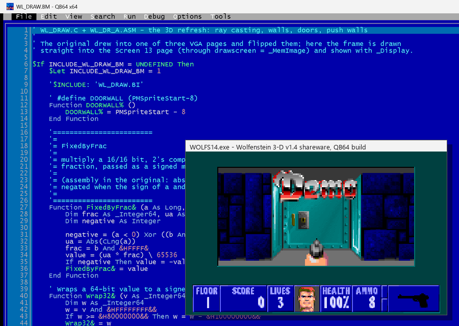

<p align="right"><i>
In memory of my friend <b>Andriy Ogorodnyk</b> (Андрій Огородник),<br>
known as <b>Страус</b>, <b>Ostrich</b>, <b>Andy Ostrich</b> and <b>Citicat</b>,<br>
who introduced me to the cool stuff in QuickBASIC back in the 1990s.
</i></p>

# Wolfenstein 3-D in QB64

A port of the original **Wolfenstein 3-D** and **Spear of Destiny** source code by id Software
([id-Software/wolf3d](https://github.com/id-Software/wolf3d)) from C and assembly to
**[QB64](https://github.com/QB64Official/qb64)**, the modern QuickBASIC-compatible compiler.

QB64 runs on Windows, Linux and macOS, but this port has only been tested on Windows, and the start
scripts below are for Windows.

The port follows the original code file by file (`WL_DRAW.C` became `basicsrc/WL_DRAW.BM`, and so on),
so the game behaves like the original: the demos of the registered Wolfenstein 3-D and of Spear of Destiny
play back exactly as in the DOS game.



## Play the shareware (v1.4)

The game data is not part of this repository. The shareware episode, *Escape from Wolfenstein*, is free
to download from the [Internet Archive](https://archive.org/details/wolf3dsw). There are three ways to set it up.

### 1. By hand, with a prebuilt binary

1. Download `WOLFS14.exe` from the [Releases](https://github.com/iandevpro/wolf3dbas/releases) page.
2. Download the shareware: [wolf3dsw.zip](https://archive.org/download/wolf3dsw/wolf3dsw.zip).
3. Unzip the eight `*.WL1` files into the folder of `WOLFS14.exe`. The zip also has the original DOS
   `WOLF3D.EXE`, which is not needed.
4. Run `WOLFS14.exe`.

### 2. With a script, using the prebuilt binary

Put `startbin.bat` and `startbin.ps1` in an empty folder and double-click `startbin.bat`. It:

1. downloads `WOLFS14.exe` from the Releases page,
2. downloads the shareware from the Internet Archive and unzips only its `*.WL1` files,
3. reports how each step went and starts the game.

Everything goes into a `wolfs14\` folder next to the script. A step whose result is already there is
skipped, so later runs just start the game.

### 3. With a script, building from source

Clone the repository (or download it as a ZIP from GitHub) and double-click `startsrc.bat`:

```
git clone https://github.com/iandevpro/wolf3dbas.git
cd wolf3dbas
startsrc.bat
```

The script:

1. uses the checkout it is in (copied to an empty folder on its own, it clones the repository into `wolf3dbas\`),
2. downloads [QB64 v2.1](https://github.com/QB64Official/qb64/releases/tag/v2.1) for Windows (a `.7z`
   archive) and unpacks it into `qb64\`, to compile the game,
3. downloads the shareware and unzips its `*.WL1` files into `wolfs14\`,
4. compiles `basicsrc\WOLFS14.BAS` into `wolfs14\WOLFS14.exe`. The first compile also builds the
   QB64 libraries and takes a few minutes,
5. reports how each step went and starts the game.

Later runs start the game straight away. Both scripts need Windows 10 or 11; they use its built-in
`curl.exe` and `tar.exe`.

## Other versions

Each version of the game data has its own build. To play the full Wolfenstein 3-D, Spear of Destiny or
the Spear of Destiny demo:

1. Get the exe of that build: download it from the [Releases](https://github.com/iandevpro/wolf3dbas/releases)
   page, or build it (see below).
2. Get the game data files of that version: the freely available shareware or demo data, or the
   files of the original game you own. Spear of Destiny had no shareware, only a demo (`*.SDM`); the
   full game is `*.SOD`. The demo is on the
   [Internet Archive](https://archive.org/details/spear-box): its
   [SOD1_BOX.zip](https://archive.org/download/spear-box/SOD1_BOX.zip) has the eight `*.SDM` files in
   its `SPEAR_BOX` folder.
3. Put the data files in the folder of the exe and run it.

The start scripts set up only the v1.4 shareware.

| Build | Data files | Game |
|---|---|---|
| `basicsrc/WOLFS14.BAS` | `*.WL1` | Wolfenstein 3-D shareware v1.4 (Internet Archive) |
| `basicsrc/WOLF1.BAS` | `*.WL1` | Wolfenstein 3-D shareware v1.0 |
| `basicsrc/WOLF3D.BAS` | `*.WL6` | Wolfenstein 3-D, all six episodes |
| `basicsrc/SPEAR.BAS` | `*.SOD` | Spear of Destiny |
| `basicsrc/SPEARDEMO.BAS` | `*.SDM` | Spear of Destiny demo |

To build one, with QB64 v2.1 in `C:\qb64`:

```
C:\qb64\qb64.exe -x basicsrc\WOLF3D.BAS -o "%CD%\WOLF3D.exe"
```

The `-o` path must be absolute: a relative one is taken from the folder of the source file. A QB64
program looks for its files in the folder of its exe, so keep the exe next to the data.

## Controls

The keys of the original game:

| Key | Action |
|---|---|
| Arrows | move and turn |
| Ctrl | fire |
| Alt + arrows | strafe |
| Right Shift | run |
| Space | open doors, use elevators |
| 1-4 | knife, pistol, machine gun, chain gun |
| Esc | menu |
| F1-F10 | help, save, load, sound, view size, controls, end game, quick save, quick load, quit |

The mouse works too, and a joystick or gamepad can be enabled and calibrated in *Options → Control*.

## Repository

| Folder | Contents |
|---|---|
| `basicsrc/` | the QB64 port: `*.BAS` builds, `*.BI` headers, `*.BM` modules |
| `origsrc/` | the original C and assembly source, for reference |
| `tools/` | Python generators for the data headers, sprite and state tables, and a source formatter |
| `plans/` | the porting plans and `porting_log.md`, a step-by-step log of the port |
| `misc_old_tools/` | early helper scripts and lists |

## Credits

- **Wolfenstein 3-D** and **Spear of Destiny** by id Software. The original source code is at
  [id-Software/wolf3d](https://github.com/id-Software/wolf3d); see its license there. The game data is
  not included: use the free shareware, or the data of a version you own.
- **QB64** by the QB64 team: [QB64Official/qb64](https://github.com/QB64Official/qb64).
