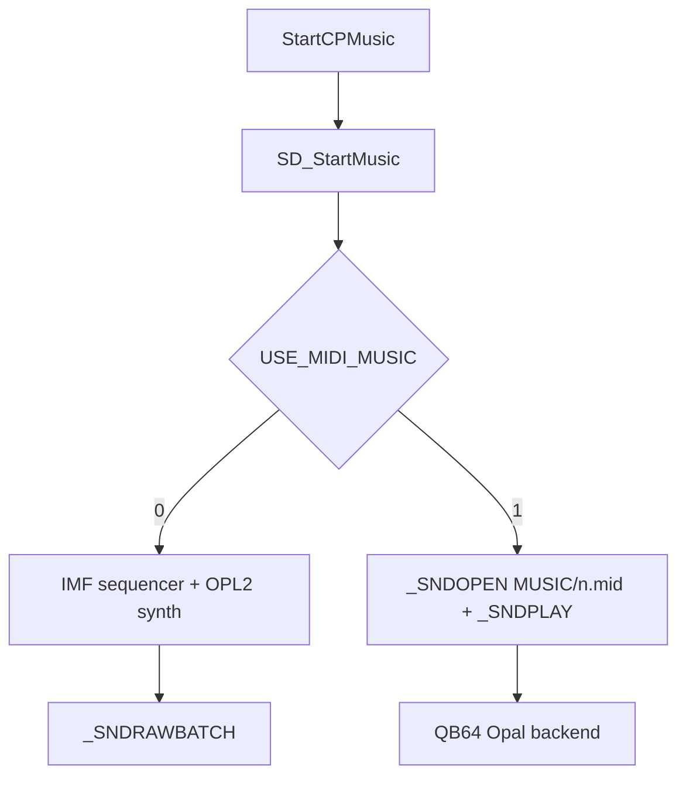
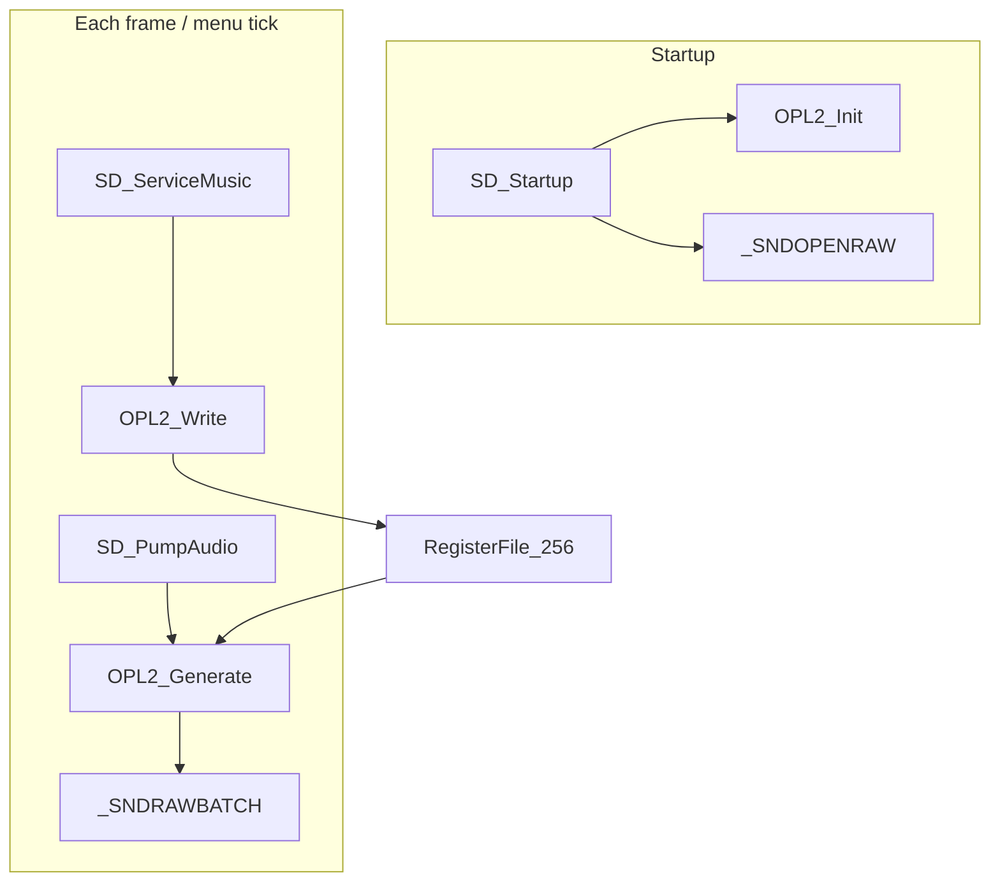

# Wolf3D Music Playback Plan (OPL2 + MIDI)

## Can QB64 MIDI be used?

**Yes, but not directly on IMF data.**

Wolf3D stores music as **IMF** (OPL2 register write streams) inside `AUDIO.WL6`, cached via `CA_CacheAudioChunk` and played by `SD_StartMusic`. QB64-PE (v3.14+) MIDI support plays **MIDI files** via `_SNDOPEN` / `_SNDPLAY`, with optional FM banks via `_MIDISOUNDBANK` (including **OP2** — the DMX OPL2 instrument format Wolf3D used).

| Format | What Wolf3D has | What QB64 MIDI plays |
|--------|-----------------|----------------------|
| IMF register stream | Yes (in memory) | No |
| Standard MIDI (.mid) | No (must convert) | Yes |
| OPL/OP2 sound bank | Embedded in IMF | Yes via `_MIDISOUNDBANK "GENMIDI.OP2"` |

QB64-PE renders MIDI through internal backends including **Opal** (OPL/OP2), so converted tracks can still sound AdLib-authentic — but the conversion IMF→MIDI is **lossy** (pitchbend approximations, instrument mapping).

**Requirement:** QB64-PE v3.14+ (stable MIDI). Classic QB64 lacks this.

## Dual-backend design (user choice: both via compile-time flag)

```basic
' In WOLF3D.BAS or ID_SD.BI — pick one at build time:
' $Let USE_MIDI_MUSIC = 0   ' default: pure QB64 OPL2 + IMF sequencer
' $Let USE_MIDI_MUSIC = 1   ' fallback: pre-converted .mid files + QB64 MIDI
```



Shared API unchanged: `SD_Startup`, `SD_StartMusic`, `SD_MusicOff`, `SD_UpdateAudio` (no-op pump for MIDI path).

---

# Path A: Pure QB64 OPL2 (default, USE_MIDI_MUSIC = 0)

## Current state

The IMF music **sequencer** is done in [`ID_SD.BM`](ID_SD.BM): it parses register/data pairs at 700 Hz and has TODO markers for `OPL2_Write(reg, data)`. Nothing produces audio yet, and **`SD_ServiceMusic` is never called** from the game loop.

Original hardware path (for reference):

```405:409:origsrc/ID_SD_A.ASM
	mov	ax,[es:di]						; Get register/value pair
	xor	bh,bh
	mov	bl,ah
	xor	ah,ah
	CALL alOut C,ax,bx
```

Register = low byte, data = high byte — matches the QB64 parser.

## Architecture

Two independent clocks:

| Layer | Rate | Responsibility |
|-------|------|----------------|
| IMF sequencer | 700 Hz | `SD_ServiceMusic` — apply register writes from cached music |
| OPL2 synth | `_SNDRATE` (~44100 Hz) | Generate PCM from chip state, queue to sound card |



## New files

### [`OPL2.BI`](OPL2.BI) — chip constants and shared state

- YM3812 constants from [`origsrc/ID_SD.EQU`](origsrc/ID_SD.EQU): operator bases (`0x20`, `0x40`, `0x60`, `0x80`, `0xE0`), channel bases (`0xA0`, `0xB0`, `0xC0`), global `0xBD`
- Channel→operator map (from original [`origsrc/ID_SD.C`](origsrc/ID_SD.C) lines 155–159):
  - carriers: `{3,4,5,11,12,13,19,20,21}`
  - modulators: `{0,1,2,8,9,10,16,17,18}`
  - rhythm ops: `{16,17,18,19,20,21}` for bass/snare/tom/cymbal/hihat
- `Type OPL2Operator` — phase (Long), envelope level (Integer), key-on state, derived freq multiplier
- Shared arrays: `oplRegs(255)`, 18 operators, 9 channels, waveform LUTs, ADSR rate LUTs
- Declarations: `OPL2_Init`, `OPL2_Reset`, `OPL2_Write`, `OPL2_Generate`

### [`OPL2.BM`](OPL2.BM) — core emulator (~400–600 lines)

**1. Initialization (`OPL2_Init`)**
- Build 4 waveform tables (1024 samples each): sine, half-sine, abs-sine, truncated-sine (OPL2 wave select bits 0–1)
- Precompute ADSR increment tables from attack/decay/sustain/release nibbles (logarithmic OPL curve approximation — same approach as DOSBox/dbopl, table-driven per tick at chip rate)
- Chip master clock: **49716 Hz**; resample to `_SNDRATE` inside `OPL2_Generate` (accumulator-based fractional stepping)

**2. Register write (`OPL2_Write reg, data`)**
- Mirror write into `oplRegs(reg)`
- Side effects:
  - `0xB0–0xB8`: key-on bit (bit 5) triggers envelope restart on both operators
  - `0xBD`: rhythm mode — enable/disable percussion operators 16–20
  - Frequency block + f-number → update per-operator phase increment

**3. Per-sample synthesis (`OPL2_Generate buffer(), count`)**
- For each output sample at `_SNDRATE`:
  - Advance chip timer by `49716 / _SNDRATE` (fixed-point)
  - For each of 18 operators with active envelope:
    - Lookup waveform sample from phase
    - Apply envelope attenuation (OPL uses ~3 dB steps; use power-of-2 or exp table)
  - For each melodic channel 0–8:
    - Read `0xC0` connection bits: modulator→carrier FM or additive parallel
    - Apply feedback (top 3 bits of `0xC0`) to modulator
  - Rhythm mode (`0xBD` bit 5): mix bass/snare/tom/cym/hihat from ops 16–20 per OPL2 rhythm map
  - Sum all channels, clip to ±1.0, write mono `SINGLE` buffer
- Use **Integer/Long fixed-point** throughout (no Double in inner loop) for QB64 performance

**4. Reset (`OPL2_Reset`)**
- Zero registers, silence all operators (matches `SDL_CleanAL` loop in original: regs `0x01–0xF4`)

## Changes to existing files

### [`ID_SD.BI`](ID_SD.BI)
- Add: `sdRawPipe&`, `sdAudioReady` flag, `sdMixBuffer()` array, `OPL2_BATCH = 1024`, `SNDRAW_TARGET = 0.2` (seconds of buffer)
- Declare: `SD_Startup`, `SD_Shutdown`, `SD_PumpAudio`

### [`ID_SD.BM`](ID_SD.BM)
- `$INCLUDE: 'OPL2.BI'` and `$INCLUDE: 'OPL2.BM'`
- **`SD_Startup`**: `OPL2_Init`, open `_SNDOPENRAW`, allocate mix buffer
- **`SD_Shutdown`**: `_SNDCLOSE sdRawPipe&`
- Replace TODOs:
  - `SD_StartMusic` → `OPL2_Reset`
  - `SD_MusicOff` → `OPL2_Reset`
  - `SD_ServiceMusic` loop → `OPL2_Write reg, regData`
- **`SD_PumpAudio`** (new):
  ```basic
  DO WHILE _SNDRAWLEN(sdRawPipe&) < SNDRAW_TARGET
      OPL2_Generate sdMixBuffer(), OPL2_BATCH
      _SNDRAWBATCH sdMixBuffer(), sdRawPipe&
  LOOP
  ```
- **`SD_UpdateAudio`** convenience wrapper: calls `SD_ServiceMusic` then `SD_PumpAudio` (single call site for game/menu loops)

### [`WOLF3D.BAS`](WOLF3D.BAS)
- Uncomment/add includes: `'$INCLUDE:'ID_SD.BM'` (and ensure `OPL2.BM` is pulled in)
- In `InitGame`, replace stub comment with `SD_Startup` (line ~312)
- In `DemoLoop` (and any wait/input loop), call `SD_UpdateAudio` each iteration so intro music (`StartCPMusic(INTROSONG)` at line 446) is audible
- Add `SD_Shutdown` before `End` for clean exit

### [`WL_GAME.BM`](WL_GAME.BM) (when game loop is enabled)
- Call `SD_UpdateAudio` inside `GameLoop` each frame (OPL2 path only)

---

# Path B: QB64 MIDI playback (USE_MIDI_MUSIC = 1)

## Asset pipeline (one-time / build step)

1. Extract IMF blobs from `AUDIO.WL6` (chunks 261+, matching `STARTMUSIC` in [`AUDIOWL6.BI`](AUDIOWL6.BI)) — 27 tracks for WL6
2. Convert each to `.mid` with **[dro2midi](https://github.com/Malvineous/dro2midi)**:
   - Wolf3D IMF runs at **700 Hz** — use `.wlf` extension or dro2midi's Wolf rate flag so timing is correct
   - Conversion constant `-c 49716` (default) matches OPL chip clock
3. Bundle output as `MUSIC/NAZI_NOR.mid`, etc., named to match song constants
4. Include **GENMIDI.OP2** (or equivalent DMX OP2 bank) for authentic instruments via `_MIDISOUNDBANK "GENMIDI.OP2"`

Optional: embed `.mid` files with `$EMBED` and load via `_SNDOPEN(_EMBEDDED$(...), "memory")` to avoid shipping loose files.

## Runtime changes in [`ID_SD.BM`](ID_SD.BM)

```basic
$If USE_MIDI_MUSIC Then
    Sub SD_Startup
        _MIDISOUNDBANK "GENMIDI.OP2"
    End Sub

    Sub SD_StartMusic (music As _Offset)
        ' Ignore IMF pointer; use song index from lastmusic_gbl
        SD_MusicOff
        sdMusicHandle& = _SNDOPEN("MUSIC/" + MusicFileName$(lastmusic_gbl))
        If sdMusicHandle& > 0 Then _SNDPLAY sdMusicHandle&
    End Sub

    Sub SD_MusicOff
        If sdMusicHandle& > 0 Then _SNDSTOP sdMusicHandle&: _SNDCLOSE sdMusicHandle&
        sdMusicHandle& = 0
    End Sub

    Sub SD_UpdateAudio
        ' No-op — QB64 renders MIDI asynchronously
    End Sub
$Else
    ' ... OPL2 path from Path A ...
$End If
```

`StartCPMusic` in [`WL_MENU.BM`](WL_MENU.BM) already sets `lastmusic_gbl = song` before `SD_StartMusic` — reuse that index for MIDI filename lookup table in `ID_SD.BI`.

## Looping

Original IMF loops in `SD_ServiceMusic` when `sqHackLen = 0`. For MIDI:
- Use `_SNDPLAY sdMusicHandle&, 1` if QB64 supports loop flag, **or**
- Poll `_SNDPLAYING(sdMusicHandle&)` in `SD_UpdateAudio` and restart when finished

## MIDI path pros / cons

| Pros | Cons |
|------|------|
| ~50 lines vs ~600 lines OPL2 core | Lossy IMF→MIDI conversion |
| No `_SNDRAW` CPU load | Extra build step + asset files |
| QB64 Opal backend is battle-tested OPL FM | Requires QB64-PE v3.14+ |
| Easy to swap soundfonts / OP2 banks | Slight pitch/instrument differences possible |

---

## Performance strategy (OPL2 path only)

- Batch generation via `_SNDRAWBATCH` (not per-sample `_SNDRAW`)
- All hot-path math: Long fixed-point, precomputed LUTs
- Skip idle operators (envelope at minimum / key-off)
- If profiling shows underruns on slower machines: reduce `OPL2_BATCH` latency target or add optional half-rate internal clock (22050 resample) behind a constant in `OPL2.BI` — only as fallback, not default

## Verification

**OPL2 path (default):**
1. Build/run with `$Let USE_MIDI_MUSIC = 0`, `AUDIO.WL6` + `VSWAP.WL6` present
2. Intro music audible after `StartCPMusic(INTROSONG)`
3. `_SNDRAWLEN` stays near target (no underruns)

**MIDI path:**
1. Build/run with `$Let USE_MIDI_MUSIC = 1`, converted `MUSIC/*.mid` + `GENMIDI.OP2` present
2. Same song switching works via `SD_MusicOff` + new `_SNDPLAY`
3. Compare against OPL2 path for acceptable quality

## Risk notes

- **OPL2 path:** Pure QB64 FM at 44.1 kHz is CPU-heavy; fixed-point + batching required
- **MIDI path:** Requires QB64-PE v3.14+, not classic QB64; IMF must be pre-converted
- **Both paths:** IMF timing cap (10 ticks/call) only affects OPL2 path; sound effects remain out of scope
